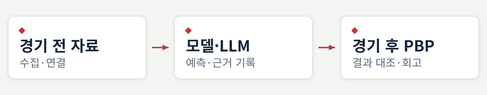
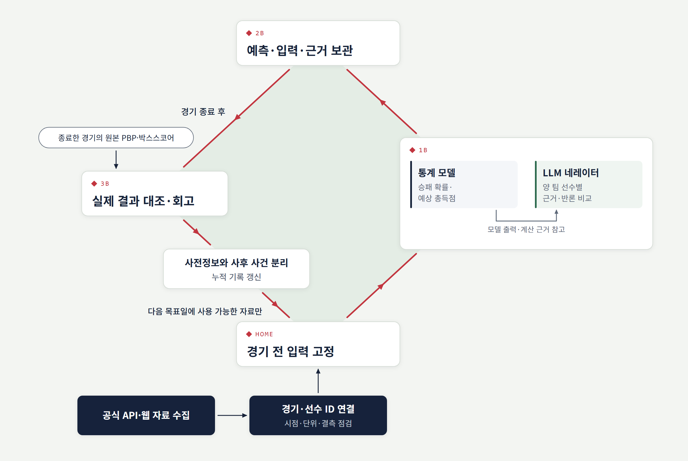

# MLB 예측·오류 분석

공식 경기 데이터로 학습 모델과 네레이터(선수별 경기 내용을 읽는 LLM 분석 모듈)를 만들고, 예측을 실제 플레이 기록과 대조해 오류를 추적한 개인 연구 프로젝트입니다.

<p>
  
  
  
  
  
  
</p>

<picture>
  <source media="(max-width: 600px)" srcset="assets/diagrams/research-flow-mobile.png">
  
</picture>

[연구 보고서](docs/RESEARCH_REPORT.md) · [소스 지도](src/README.md) · [개발·연구 이력](docs/WORK_HISTORY.md) · [상세 구조도](assets/diagrams/architecture.png)

**기간** 2025년 GPT 사전 시도 → 2026년 본격 개발 → 연구·운영 종료

## 목차

- [프로젝트 개요](#프로젝트-개요)
- [무엇을 구현했나](#무엇을-구현했나)
- [전체 구조](#전체-구조)
- [문제와 수정](#문제와-수정)
- [실험 결과와 한계](#실험-결과와-한계)
- [내 역할과 AI 활용](#내-역할과-ai-활용)
- [기술 구성](#기술-구성)
- [문서와 저장소 구성](#문서와-저장소-구성)
- [자료 출처와 포함 범위](#자료-출처와-포함-범위)

## 프로젝트 개요

승패 확률과 예상 총득점에 선수별 경기 내용을 더해 예측 근거를 설명하려 했습니다. 네레이터는 양 팀의 선발·타선·불펜과 경기 환경을 비교하고, 경기 후에는 원본 플레이 기록(PBP)으로 판단을 되짚었습니다.

| 구분 | 내용 |
|---|---|
| 연구 질문 | 경기 전 알 수 있었던 근거를 예측에서 놓친 이유는 무엇인가? |
| 접근 | 자료 연결 → 모델·LLM 비교 → PBP 대조 → 입력·판단 오류 추적 |
| 학습 규모 | 후기 모델 메타데이터 기준 **12,149경기** |
| 입력 특성 | **승패 202개 · 총득점 190개** |
| 연구 상태 | 연구·운영 종료. LLM 예측 개선 효과는 입증하지 못함 |

학습 규모와 특성 수는 후기 모델 기준입니다. 모든 실험이 동일한 입력·모델을 사용한 것은 아닙니다.

## 무엇을 구현했나

| 영역 | 구현한 내용 |
|---|---|
| 데이터 수집·연결 | 공식 경기·투구·타구 자료와 시장·환경 정보를 경기·선수 ID로 연결. 중복, 결측, 단위, 입력 시점 점검 |
| 학습 모델 | 계산 규칙에서 학습 모델로 확장. 승패 확률과 예상 총득점 산출, 입력 누수 조사와 재학습 |
| LLM 네레이터 | 양 팀 선수별 근거와 반론 비교. 모델의 계산 근거를 참고하고 별도 판단을 실험 |
| 결과 대조·회고 | 맞은 경우와 틀린 경우, 모델과 네레이터가 갈린 경우를 실제 플레이 기록으로 확인 |
| 재현·실행 관리 | 예측 당시 입력 고정, 경기별 실패 격리, 종료 경기 증분 갱신, 원격 처리와 토큰 비용 측정 |

## 전체 구조

경기 전 입력을 고정한 뒤 모델과 네레이터의 근거를 보관합니다. 경기 종료 후 PBP·박스스코어와 대조하고, 사전정보와 사후 사건을 나눠 누적 기록을 갱신합니다.

<details>
<summary><strong>수집부터 결과 대조까지: 상세 구조도 펼치기</strong></summary>

<p align="center">
  <a href="assets/diagrams/architecture.png"></a>
</p>

[원본 크기로 보기](assets/diagrams/architecture.png) · [벡터 SVG](assets/diagrams/architecture.svg) · [같은 내용의 텍스트 원본(Mermaid)](assets/diagrams/architecture.mmd)

</details>

도식은 개발 과정에서 다룬 처리 흐름을 요약합니다. 모델과 네레이터의 입출력은 한 단계 안에 묶어 표현했습니다. 모든 실험 기능을 하나의 운영 경로에 동시에 적용한 것은 아닙니다.

선수별 근거 연결, 추론 실행, 출력 검사와 회고의 세부 흐름은 아래 문서에서 볼 수 있습니다. 각 문서에는 검정 배경 도식, 확대 가능한 SVG와 단계별 확대본을 함께 넣었습니다.

| 상세 문서 | 확인할 내용 |
|---|---|
| [네레이터 구조와 긴 입력 대응](docs/NARRATOR_ARCHITECTURE.md) | PBP 정독·선수별 기록 누적 → 사전 입력 → 경기별 추론·검사·회고. Lost in the Middle에 대응한 입력 도달 검사, 메모장, 섹션별 중간 기록 |
| [판단기준 추출과 적용](docs/JUDGMENT_CRITERIA.md) | 실제 경기를 읽어 사전 근거의 판단 방법을 추출하고, 새 경기 조건과 반대 근거에 대조한 과정 |
| [머신러닝 학습·예측 구조](docs/ML_ARCHITECTURE.md) | 경기 이전 특성 구성, 시간순 평가, 최종 재학습, 예측 당시 입력·근거 보존 |

## 문제와 수정

| 발견한 문제 | 추적·수정한 내용 |
|---|---|
| 누적 투수 성적에 당일 결과 포함 | 경기별 기록을 추적하고 경기 전 기록으로 입력을 다시 구성한 뒤 학습 모델 변경 |
| 조인 후 경기 수 증가·기록 단위 불일치 | 중복 조인과 단위, 공식 기록 귀속 점검 |
| 경기 후 빈 시장가격이 사전 수집값을 덮어씀 | 결과 갱신 시 기존 경기 전 수집값을 보존하도록 수정 |
| 모델과 네레이터의 판단 근거 대조가 어려움 | 예측 당시 입력과 모델 계산 근거를 별도로 보관 |
| 근거를 전달해도 최종 판단에서 반영하지 못함 | 분야별 근거 분리, 양 팀 반론 비교, 판단기준 검색·적용과 최종 판단 분리를 실험 |

## 실험 결과와 한계

### 정독 비용 측정

| 항목 | 이전 실행 | 변경 후 실행 |
|---|---:|---:|
| 실행시간 | 530.06초 | 300.05초 |
| 출력 토큰 | 24,863 | 15,626 |

한 경기 실험의 측정값입니다. 캐시 제외 입력 감소는 3.8%였고, 입력 구성이 다른 비교이므로 품질이 같다고 보증할 수는 없습니다.

### 예측 성능의 한계

표본과 입력 조건이 다른 실험을 하나의 대표 적중률로 합치지 않았습니다. 승패 모델은 시즌 단위 시간순 평가(2021~2023 학습, 2024 검증, 2025 테스트 2,416경기)에서 정확도 56.6%였고, 시장 확률보다 나은 예측력은 확인하지 못했습니다. **LLM의 최종 판단 일관성과 예측 개선 효과는 끝내 입증하지 못했습니다.** 통계 기준을 통과하지 못한 후기 판정 방법은 운영에 적용하지 않았습니다.

세부 실험의 조건, 결과, 적용 여부는 [연구 보고서](docs/RESEARCH_REPORT.md)에 구분해 기록했습니다.

## 내 역할과 AI 활용

문제 정의, 수집 자료 확장, 비교 실험과 검증 요구, 적용·종료 판단을 맡았습니다. 코드 작성과 검토에는 Claude와 Codex를 활용했습니다. AI가 제안한 결과를 그대로 채택하지 않고, 원본 기록과 실행 산출물을 대조하도록 요구하며 구현을 수정했습니다.

## 기술 구성

| 영역 | 단계별 사용 기술 |
|---|---|
| 수집·가공 | Python, pandas, API·웹 수집, CSV/Parquet |
| 모델링 | scikit-learn, XGBoost, LightGBM |
| 근거 분석 | Claude, Codex, MCP, 경기별 근거·판단 기록 |
| 실행·보관 | Colab, Google Drive API, 로컬 파일 기반 실행·검증 |

## 문서와 저장소 구성

| 문서 | 내용 |
|---|---|
| [연구 보고서](docs/RESEARCH_REPORT.md) | 시작 계기, 수집·모델 개발, 오류 사례, 비교 실험, 한계 |
| [개발·연구 이력](docs/WORK_HISTORY.md) | 주제별 구현과 개선 과정 |
| [구조도 텍스트 원본](assets/diagrams/architecture.mmd) | 그림과 같은 내용을 연결별로 기록한 Mermaid 문서 |
| [네레이터 상세 구조](docs/NARRATOR_ARCHITECTURE.md) | 선수별 기록·격리 추론·긴 입력 대응을 세부 도식으로 설명 |
| [판단기준 상세 구조](docs/JUDGMENT_CRITERIA.md) | 추출과 검색·조건 적용을 별도 도식으로 설명 |
| [머신러닝 상세 구조](docs/ML_ARCHITECTURE.md) | 평가·재학습·예측의 연결과 경계를 설명 |
| [상세 도식 모음](assets/diagrams/details/README.md) | 5개 Mermaid/SVG/PNG와 단계별 확대본 |
| [소스 지도](src/README.md) | 수집·학습·네레이터·회고의 코드 위치와 세대 구분 |
| [코드 정리 변경표](docs/CODE_CHANGELOG.md) | 운영 원본에서 제외·변경한 부분과 검수 범위 |

<details>
<summary><strong>저장소 파일 구성</strong></summary>

```text
mlb-prediction-error-analysis/
├── README.md
├── docs/
│   ├── RESEARCH_REPORT.md
│   ├── WORK_HISTORY.md
│   ├── NARRATOR_ARCHITECTURE.md
│   ├── ML_ARCHITECTURE.md
│   ├── JUDGMENT_CRITERIA.md
│   ├── CODE_CHANGELOG.md
│   ├── CODE_DEPENDENCIES.md
│   └── CODE_MANIFEST.json
├── src/                    # 핵심 구현과 선수별 자료 연결
├── experiments/            # 대표 연구 실험
├── archive/                # 과거 코드·수정 전후 발췌
├── notebooks/archive/      # 초기 노트북, 저장 출력 제거
├── prompts/                # 당시 분석·정독 지침
├── tests/                  # 기존 회귀검사 소스, 실행 미검증
└── assets/
    └── diagrams/
        ├── architecture.mmd
        ├── architecture.png
        ├── architecture.svg
        ├── research-flow.mmd
        ├── research-flow.png
        ├── research-flow-mobile.mmd
        ├── research-flow-mobile.png
        └── details/             # 세부 Mermaid·SVG·PNG·확대본
```

</details>

## 자료 출처와 포함 범위

시장가격(배당) 자료는 모델 입력과 시장 확률 비교에, 총득점 기준점은 예측 점수와 비교하는 데 사용했습니다. 공식 기록과 웹 수집 자료의 출처·역할·평가 범위는 연구 보고서의 [자료 출처와 평가 범위](docs/RESEARCH_REPORT.md#자료-출처와-평가-범위)에 정리했습니다.

이 저장소에는 연구 문서·구조도와 **핵심 구현·대표 실험·초기 노트북을 고른 소스 발췌본 87개**를 포함합니다. 운영 원본과 동일한 배포본은 아닙니다. 시장가격 사이트 수집 구현, 메시지 송신·금액 계산, 원천 데이터, 모델 가중치, 인증정보와 내부 협업 기록은 제외했습니다. MLB 공식 자료는 [MLB Advanced Media 이용 조건](http://gdx.mlb.com/components/copyright.txt)상 개인·비상업·비대량 이용만 허용되고 그 밖의 이용에는 사전 서면 허가가 필요해서, 수집한 원천 데이터를 저장소로 재배포하지 않았습니다.

코드의 변수·파일 이름 일부는 공개를 위해 중립적인 이름으로 바꿨습니다. 계산은 같지만, 이름이 운영 당시 원본 및 원본 데이터의 열 이름과 다릅니다.

데이터뿐 아니라 일부 의존 모듈도 포함하지 않아 **데이터만 추가해도 전체 파이프라인이 바로 실행되는 구성은 아닙니다.** [소스 지도](src/README.md)와 [의존성 경계](docs/CODE_DEPENDENCIES.md)에 범위를 명시했습니다. 이번 코드 정리는 정적 검수이며 학습·추론·노트북 실행이나 성능 재현을 다시 수행한 것은 아닙니다.
