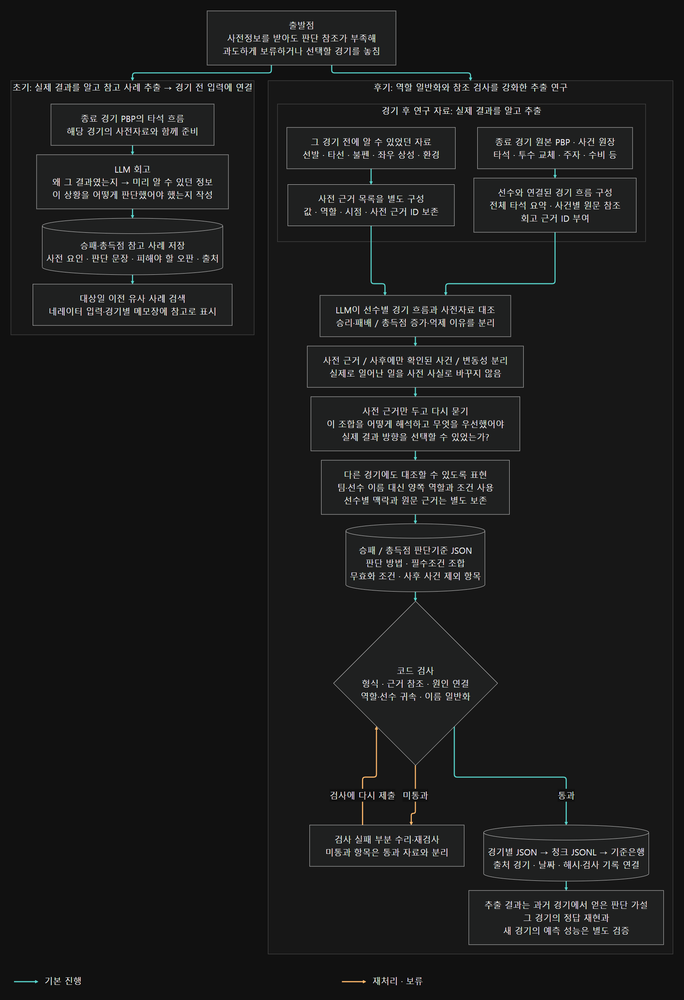
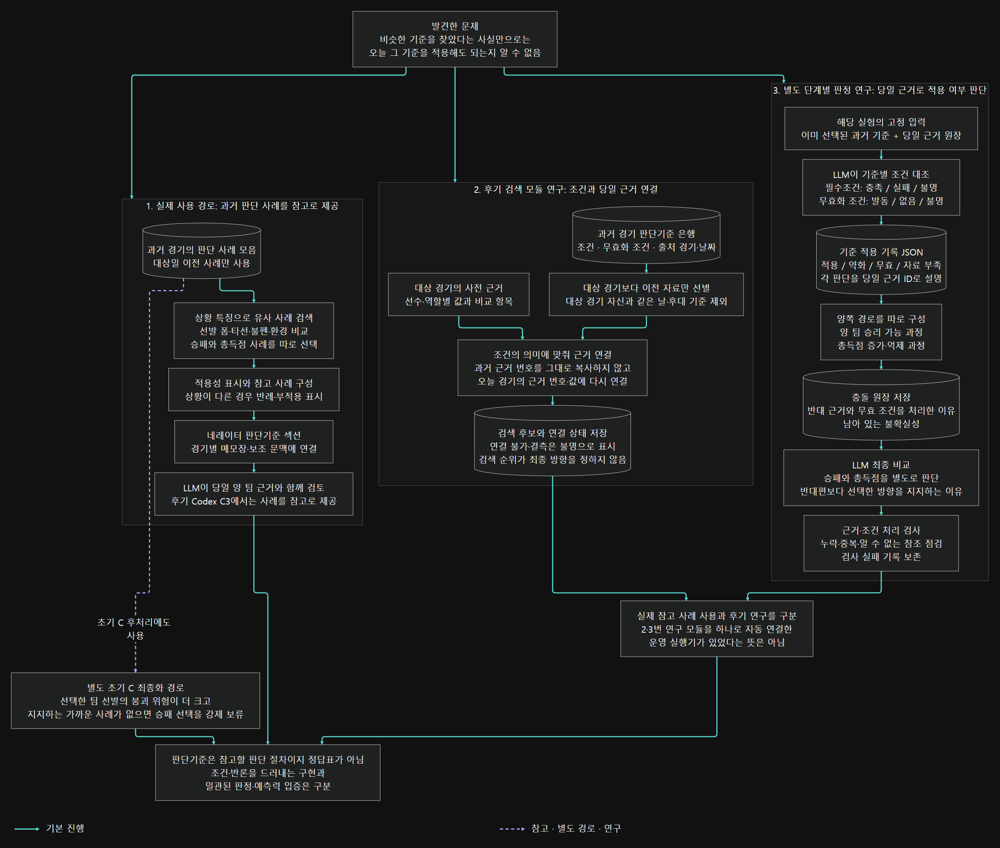

# 판단기준을 추출하고 적용한 과정

[프로젝트 개요](../README.md) · [네레이터 구조](NARRATOR_ARCHITECTURE.md) · [연구 보고서](RESEARCH_REPORT.md)

## 왜 판단기준을 만들었나

선수별 사전정보를 전달해도 네레이터가 충돌하는 근거를 제대로 비교하지 못하는 경우가 있었다. 종합 성적을 앞세우고 상대 선수의 구체적인 득점·억제 경로를 가볍게 보거나, 판단 참조가 부족해 과도하게 보류하고 선택할 경기를 놓치는 문제가 남았다. 과거 경기를 읽으며 **이런 사전정보 조합에서는 무엇을 어떻게 봤어야 했는지**를 자연어 판단기준으로 남기려 했다.

목표는 모델의 선택을 따르게 하거나, 신호 개수를 세는 점수표를 하나 더 만드는 것이 아니었다. 새로운 경기의 사전정보를 읽는 LLM에 비교할 판단 절차를 제공하는 것이었다.

## 추출 구조도

[확대 가능한 SVG](../assets/diagrams/details/criterion-extraction.svg) · [PNG 원본](../assets/diagrams/details/criterion-extraction.png) · [Mermaid 원문](../assets/diagrams/details/criterion-extraction.mmd)

- [초기 추출·실제 사용 확대본](../assets/diagrams/details/criterion-extraction--EARLY.png)
- [후기 역할 일반화·검사 확대본](../assets/diagrams/details/criterion-extraction--LATER.png)

## 1. 초기 참고 사례 추출과 실제 사용

초기 추출기는 종료 경기 PBP의 타석 흐름과 해당 경기의 사전자료를 LLM에 제공했다. 승패·총득점의 실제 이유, 사전에 알 수 있던 사실, 사후 사건, 피해야 할 판단, “이 상황을 어떻게 봤어야 했는가”를 사례별로 기록했다. 이 추출은 결과를 알고 하는 회고이며, 내용만 먼저 읽는 일반 정독 단계와 입력 구성이 다르다.

저장된 사례는 대상일보다 이전 자료에서 검색해 네레이터 프롬프트의 판단기준 섹션과 경기별 메모장에 연결했다. 같은 팀인지보다 선발 폼·타선·불펜·환경 등 상황 특징을 비교하도록 검색을 보완했고, 승패와 총득점 사례도 나눴다. 조건이 맞지 않는 사례는 부적용·반례로 표시했다. 이는 실제 사용 코드에 연결된 참고 자료 경로이며, 후기 연구만 존재했던 것은 아니다.

후기 Codex C3에서는 사례를 LLM이 읽는 참고 자료로 제공했다. 다만 초기 C 경로의 최종화에는 별도 보류 게이트가 있었다. 선택한 팀의 선발이 상대보다 더 붕괴 위험이 큰 조건이고 그 선택을 지지하는 적용 가능한 가까운 사례가 없으면 승패 선택을 비워 보류시켰다. 따라서 모든 시기의 사례 활용을 단순 참고였다고 묶어 설명할 수는 없다.

확인한 후기 C3 실행·조립·계약검사 파일에는 이 초기 게이트의 직접 호출이 없다. 이는 후기 경로에 다른 검사나 보류 조건도 전혀 없다는 뜻은 아니다. 코드 연결의 존재와 모든 날짜에 적절한 사례가 생성돼 실제 판단에 반영됐다는 보증도 구분한다.

## 2. 후기 역할 일반화·참조 검사 추출

1. **실제 경기와 당시 사전정보를 함께 준비했다.** 원본 PBP에서 전체 타석 흐름과 선수·사건 원장을 구성하고, 그 경기 전에 알 수 있었던 선발·타선·불펜·상성·환경 자료는 따로 고정했다.
2. **LLM이 경기 흐름을 읽었다.** 선수 이름과 타석·투수 교체·주자·수비 사건을 연결하고, 승패와 총득점의 이유를 각각 설명하게 했다. 결과를 알고 하는 회고 단계다.
3. **사전 근거와 사후 사건을 분리했다.** 회고 설명에는 경기 사건 참조를, 사전 사실과 기준 조건에는 당시 사전자료 참조를 붙였다. 실제 구원투수가 무너졌다는 사실만으로 그 붕괴를 미리 알 수 있었다고 쓰지 못하게 했다.
4. **사전정보만으로 판단 방법을 역으로 검토했다.** “이런 정보 조합에서 어떤 근거를 우선해 어떻게 판단했어야 실제 결과 방향을 선택할 수 있었는가?”를 묻고, 지지 근거뿐 아니라 반대 근거도 보존했다.
5. **팀 이름이 아닌 역할·조건으로 표현했다.** 일반화한 기준에는 양쪽 선발·타선·불펜 같은 역할을 썼다. 원래 경기 설명의 선수와 출처는 보존했다. 이름만 바꾸고 야구 맥락까지 지우는 것이 목적은 아니었다.
6. **형식과 근거 연결을 검사하고 저장했다.** 경기별 JSON을 검사한 뒤 통과 자료를 청크 JSONL로 묶었다. 실패한 경기만 수리할 수 있도록 원본·프롬프트·출력 해시와 검사 기록을 연결했다.

해당 추출기의 LLM 입력은 원본 JSON의 모든 필드를 그대로 붙인 형태가 아니다. 전체 타석 요약과 사건별 원문 참조를 가진 회고 근거 목록, 별도의 사전 근거 목록을 사용한다. 선택한 사건의 원문 상세 파일도 구성하지만, 파일이 존재한다는 이유만으로 매 호출에서 그 세부 필드를 전부 읽었다고 주장하지 않는다.

### 기준에 저장한 내용

| 항목 | 담은 내용 |
|---|---|
| `correct_view_method` | 이 사전정보 조합을 어떻게 해석하고 판단할지 |
| `required_combination` | 해당 판단을 적용하려면 함께 있어야 하는 조건과 사전 근거 |
| `invalidators` | 그 판단을 뒤집거나 적용하지 못하게 하는 조건과 사전 근거 |
| `post_only_exclusions` | 경기 후 알게 된 사건이므로 판단 조건에서 제외할 내용 |

승패와 총득점은 별도 항목으로 저장했다. 경기 흐름, 결과 원인, 사전 요인, 사후 요인, 변동성, 참조도 함께 남겼다. 기준을 만들면서 결과를 봤으므로 이 단계의 방향 일치는 예측 적중률이 아니다. 다음 경기에서 검증할 가설을 만든 것이다.

## 적용 구조도

[확대 가능한 SVG](../assets/diagrams/details/criterion-application.svg) · [PNG 원본](../assets/diagrams/details/criterion-application.png) · [Mermaid 원문](../assets/diagrams/details/criterion-application.mmd)

- [실제 참고 사례 사용 확대본](../assets/diagrams/details/criterion-application--USED.png)
- [검색·당일 근거 연결 확대본](../assets/diagrams/details/criterion-application--RETRIEVE.png)
- [조건 대조·최종 판단 확대본](../assets/diagrams/details/criterion-application--APPLY.png)

## 3. 적용 문제를 다룬 후속 연구

후기 검색 모듈은 출처 경기 날짜가 대상 날짜보다 이전인 기준으로 제한했다. 자기 경기와 같은 날·후대 경기의 기준이 들어오면 거절하도록 했고, 과거 경기의 근거 번호를 새 경기에서 그대로 쓰지 않도록 의미가 같은 항목의 **당일 값과 근거 번호**에 다시 연결했다.

하지만 검색이 됐다는 사실만으로 적용이 정당해지지는 않았다. 비슷한 기준의 검색 점수를 우선하거나 종합지표에 끌리면, 해당 기준을 무효화하는 상대 선수의 근거를 다시 묻을 수 있었다.

별도 단계별 판정 실험에서는 다음을 나눠 기록했다.

- 필수조건이 당일 자료에서 충족됐는가, 실패했는가, 알 수 없는가.
- 무효화 조건이 실제로 발동했는가. 결측을 “무효 조건 없음”으로 처리하지 않는가.
- 따라서 기준이 적용되는가, 약해졌는가, 무효인가, 자료가 부족한가.
- 양 팀의 승리 경로와 총득점 증가·억제 경로 중 무엇이 반론을 견디는가.
- 최종 방향에서 반대 근거를 어떻게 처리했는가.

각 단계의 JSON을 다음 단계가 읽게 하고 처리 누락을 검사했다. 후기 검색용 코드와 이 단계별 판정 실험은 서로 다른 연구 구현이다. 공개된 후기 검색 모듈만으로 LLM 조건 판정과 최종 추론까지 자동 실행되는 것처럼 표현하지 않는다. 이 경계가 앞서 설명한 실제 참고 사례 사용 경로까지 없었다는 뜻은 아니다.

## 확인한 것과 남은 것

구현으로 남긴 것은 **경기 사건 → 당시 사전 근거 → 판단 방법 → 새 경기 조건 대조**를 추적할 수 있는 구조다. 조건·반론·무효화 이유가 기록에 남으므로 검색, 근거 연결, 조건 해석, 최종 선택 중 어디에서 문제가 생겼는지 구분할 수 있다.

반면 기준 수가 늘었다거나 JSON 검사를 통과했다는 사실은 새로운 경기에서 유효한 기준이라는 증명이 아니다. 경기 날짜를 나누는 검사도 결과를 알고 만든 가설의 사후 편향까지 없애지는 않는다. 새로운 경기에서의 유효성, 판정 일관성과 예측력 개선은 별도 검증이 필요했고, 모든 판단 오류를 해결했다고 결론 내리지는 않았다.

원래 목표는 과도한 보류와 놓친 판단을 줄이는 것이었다. 사례 연결·형식·처리 검사의 성공을 그 목표의 개선과 같은 성과로 쓰지 않는다. 특정 시기의 목표별 평가 누락을 프로젝트 전체에서 평가가 전혀 없었다는 주장으로 확대하지도 않는다.

## 공개 코드에서 확인할 위치

| 구성 | 공개 소스 |
|---|---|
| 기준 추출·검사·청크 처리 | [_mlb_direction_criterion_season_extract.py](../experiments/criteria/_mlb_direction_criterion_season_extract.py) |
| 날짜 제한·당일 근거 재연결 | [_mlb_direction_criterion_retrieval.py](../experiments/criteria/_mlb_direction_criterion_retrieval.py) |
| 실제 참고 사례 입력 | [_narr_reasoning.py](../src/_narr_reasoning.py), [_mlb_narr_c3_per_game_run.py](../src/_mlb_narr_c3_per_game_run.py) |
| 별도 단계별 적용·충돌 판정 | [_mlb_layered_adjudicator_research.py](../experiments/adjudication/_mlb_layered_adjudicator_research.py) |

초기 사례 빌더·메모장 빌더·초기 C 보류 게이트 등 일부 구현은 공개 발췌본에 포함하지 않았다. [소스 지도](../src/README.md), [의존성 경계](CODE_DEPENDENCIES.md), [도식 표시 규칙](../assets/diagrams/details/README.md)에 공개 범위를 구분했다.
