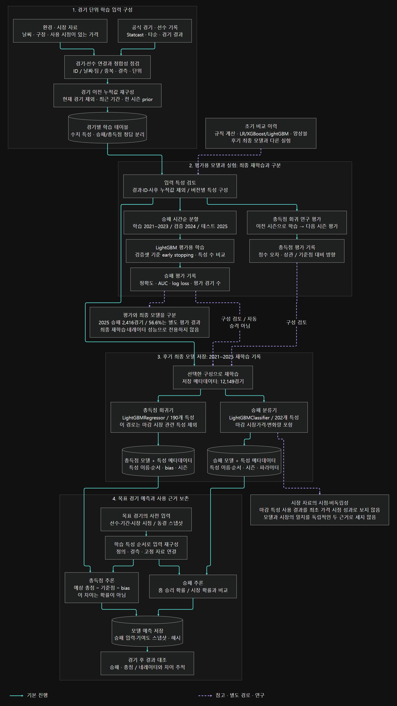

# 머신러닝 학습과 예측 구조

[프로젝트 개요](../README.md) · [네레이터 구조](NARRATOR_ARCHITECTURE.md) · [연구 보고서](RESEARCH_REPORT.md)

경기별 학습 테이블을 만든 뒤 승패 분류와 총득점 회귀를 나눠 학습했다. 평가용 모델, 최종 재학습 모델, 목표 경기의 예측 입력을 구분해 그렸다. 초기 규칙 계산·LR·XGBoost·LightGBM·앙상블 비교를 후기 최종 모델 하나의 구성으로 합치지 않았다.

[확대 가능한 SVG](../assets/diagrams/details/ml-detail.svg) · [PNG 원본](../assets/diagrams/details/ml-detail.png) · [Mermaid 원문](../assets/diagrams/details/ml-detail.mmd)

## 1. 학습 입력을 경기 이전 시점으로 구성

공식 경기·선수 기록, Statcast, 환경·시장 자료를 경기·선수·팀·시즌 키로 연결했다. 중복 조인, 결측, 기록 단위를 확인하고 현재 경기 결과를 제외한 누적값·최근 기간·전 시즌 prior를 구성했다.

[입력 구성 확대본](../assets/diagrams/details/ml-detail--F.png)

## 2. 시간순 평가와 모델 선택

승패의 저장된 시즌 단위 평가는 2021~2023 학습, 2024 검증, 2025 테스트로 나뉜다. 검증 데이터로 early stopping과 특성 수를 비교했고, 2025년 테스트 2,416경기의 정확도는 56.6%였다. 이 결과를 최종 재학습 모델이나 네레이터의 성과로 옮겨 적지 않았다.

총득점은 별도 회귀 연구에서 이전 시즌으로 다음 시즌을 평가했다. 점수 오차·상관·기준점 대비 방향은 승패 분류 정확도와 다른 지표다.

[평가 과정 확대본](../assets/diagrams/details/ml-detail--E.png)

## 3. 후기 최종 모델 재학습

보존된 후기 모델 메타데이터는 2021~2025 재학습 12,149경기, 승패 202개 특성, 총득점 190개 특성이다. 승패는 LightGBMClassifier, 총득점은 LightGBMRegressor를 사용했고 모델 파일과 특성 정의를 함께 저장했다. 이 숫자는 해당 판본 기준이며 모든 실험의 공통 조건은 아니다.

승패 경로에는 마감 시장가격·변화량 특성이 포함됐다. 반면 도식의 총득점 최종 학습 경로는 마감 시장 관련 특성을 제외했다. 마감 자료를 사용한 성과를 최초 가격 시점 성과로 해석하지 않는다.

[최종 재학습 확대본](../assets/diagrams/details/ml-detail--T.png)

## 4. 예측 입력과 당시 근거 보존

목표 경기의 사전 입력을 고정하고 학습 당시 특성 순서에 맞춰 재구성했다. 승패는 홈 승리 확률과 시장 환산 확률을 비교한다. 총득점의 `예상 총점 - 기준점 - bias`는 점수 차이이며 확률이 아니다.

모델의 결과와 승패 입력·기여도·스냅샷 해시를 남겨 네레이터가 모델의 계산 근거를 참고하고, 경기 후 두 분석의 차이를 추적하도록 했다. 시장 자료를 모델이 이미 읽었다면 모델과 시장의 일치를 독립 근거 두 개로 세지 않는다.

[예측·보존 확대본](../assets/diagrams/details/ml-detail--I.png)

## 공개 코드에서 확인할 위치

| 단계 | 공개 소스 |
|---|---|
| 경기별 학습 테이블 | [_mlb_build_train.py](../src/_mlb_build_train.py) |
| 경기 이전 누적값 | [_mlb_sp_asof_clean.py](../src/_mlb_sp_asof_clean.py), [_mlb_sc_features.py](../src/_mlb_sc_features.py) |
| 승패 시간순 평가 | [_mlb_train_v3.py](../src/_mlb_train_v3.py) |
| 최종 재학습 | [_mlb_train_deploy.py](../src/_mlb_train_deploy.py), [_mlb_train_deploy_run_total.py](../src/_mlb_train_deploy_run_total.py) |
| 목표 경기 예측·계산 근거 | [run_mlb_v3.py](../src/run_mlb_v3.py), [_mlb_pregame_freeze_inputs.py](../src/_mlb_pregame_freeze_inputs.py) |
| 결과 대조 | [run_mlb_update.py](../src/run_mlb_update.py), [_mlb_prediction_delta_review.py](../src/_mlb_prediction_delta_review.py) |

시장 확률보다 나은 예측력이나 네레이터 도입에 따른 일반적인 개선은 확인하지 못했다. 원천 데이터·모델 가중치·일부 의존 모듈은 공개에서 제외했다. [평가 범위와 한계](RESEARCH_REPORT.md), [도식 표시 규칙](../assets/diagrams/details/README.md)을 함께 본다.
