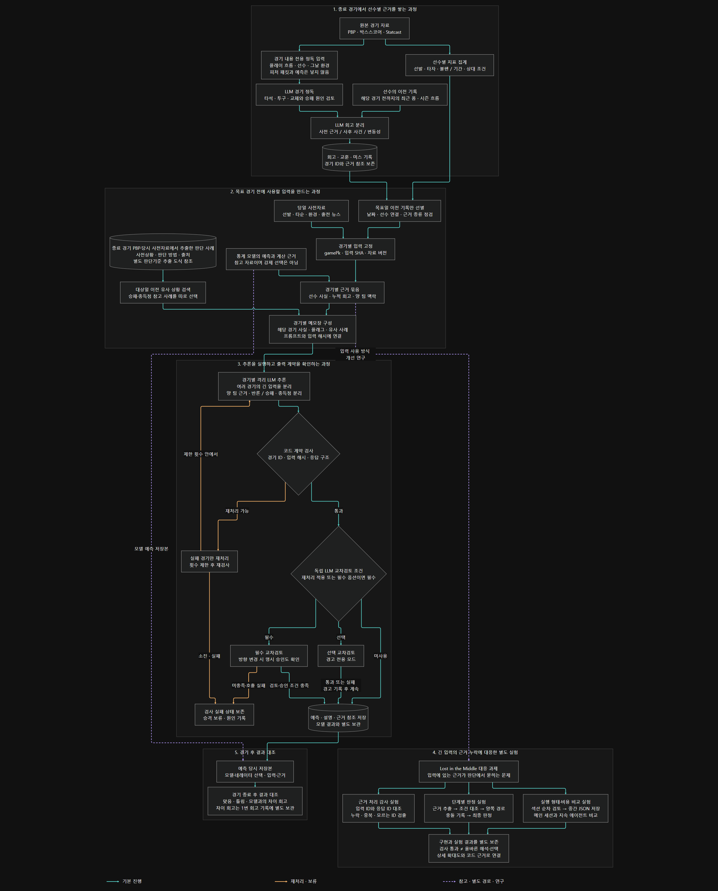
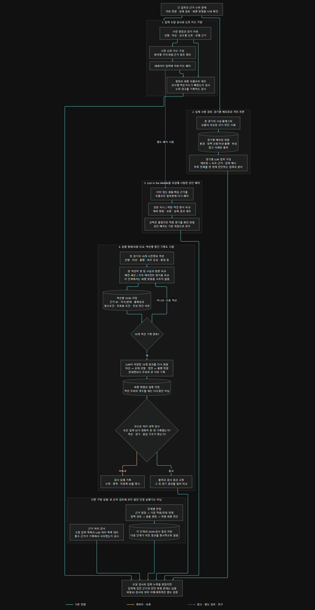

# 선수별 경기 내용을 읽는 네레이터

[프로젝트 개요](../README.md) · [머신러닝 구조](ML_ARCHITECTURE.md) · [판단기준 추출과 적용](JUDGMENT_CRITERIA.md)

## 왜 별도 분석 모듈을 만들었나

학습 모델은 경기 단위로 정리한 수치 특성을 읽는다. 선수의 누적 성적을 사용할 수는 있지만, 그 성적을 만든 개별 타석과 투수 교체, 주자·수비 상황의 전개를 직접 읽는 구성은 아니었다. 이를 보완하기 위해 LLM이 PBP를 읽고 선수별 기록과 대조하는 네레이터를 만들었다.

목표는 모델의 선택을 그대로 설명하게 하는 것이 아니었다. 양 팀의 선발·타선·불펜과 경기 환경을 비교하고, 모델의 계산 근거도 참고하되 반대 근거를 검토하게 했다. 경기 후에는 맞은 경우와 틀린 경우를 모두 돌아보며 사전에 확인할 수 있던 근거와 사후 사건을 구분했다.

## 전체 처리 흐름

[확대 가능한 SVG](../assets/diagrams/details/narrator-detail.svg) · [PNG 원본](../assets/diagrams/details/narrator-detail.png) · [Mermaid 원문](../assets/diagrams/details/narrator-detail.mmd)

| 단계 | 하는 일 | 확대본 |
|---|---|---|
| 종료 경기 정독·기록 누적 | 경기 내용을 읽고 선수별 지표·이전 폼과 대조해 회고·교훈·미스 기록을 보관 | [1. 누적 과정](../assets/diagrams/details/narrator-detail--H.png) |
| 경기 전 입력 구성 | 목표일 이전 기록과 당일 선발·타순·환경을 연결하고 입력 해시 고정 | [2. 입력 구성](../assets/diagrams/details/narrator-detail--P.png) |
| 경기별 추론·검사 | 양 팀 근거와 반론을 비교하고 출력 계약 검사·제한 재처리·교차검토 조건 확인 | [3. 추론과 검사](../assets/diagrams/details/narrator-detail--D.png) |
| 긴 입력 대응 연구 | 입력 도달, 단계별 기록, 실행 형태·비용을 각각 시험 | [4. 연구 분기](../assets/diagrams/details/narrator-detail--STUDY.png) |
| 경기 후 결과 대조 | 당시 저장한 모델·네레이터 선택과 실제 결과의 차이를 회고 | [5. 결과 대조](../assets/diagrams/details/narrator-detail--AFTER.png) |

일반 정독의 첫 입력은 경기 내용과 그날 환경이다. 피처 패킷이나 예측을 넣지 않고 내용을 읽은 뒤, 합성 단계에서 경기 이전 선수 폼과 대조한다. 예측 당시 모델·네레이터의 선택을 비교하는 차이 회고는 별도 경로다. 사전자료와 결과를 함께 제공하는 판단기준 추출 연구와 이 일반 정독을 혼동하지 않는다.

경기 전 분석에서 과거 PBP 전량을 매번 다시 읽는 것은 아니다. 선수와 연결된 누적 기록, 사전자료, 참고 사례를 경기별로 구성해 전달한다. 수치 집계는 데이터 처리 코드가 맡고, LLM은 그 근거를 읽고 비교한다.

### 실행과 검사의 경계

- 경기별 격리 추론에서는 같은 입력 스냅샷의 해시를 묶음·프롬프트·출력에 연결한다. 실패한 경기만 제한적으로 재처리한다.
- C3의 계약 검사는 경기 ID·입력 해시·응답 구조 등을 확인하는 코드 검사다. 독립 LLM 교차검토와는 다르다.
- 독립 검토는 미사용·선택·필수로 구분된다. 필수 옵션 또는 재처리 적용 시 필수이며, 필수 검토 실패는 보류한다. 선택 검토 실패는 경고를 남기고 계속하는 경로가 있다.
- 검사 통과는 예측의 정답이나 근거 해석의 정확성을 보증하지 않는다.

## Lost in the Middle에 대응한 입력·기록 구조

선수 자료를 수집했어도 최종 프롬프트에 도착하지 않을 수 있었고, 전달된 반대 근거가 최종 판단에서 빠지는 경우도 있었다. 먼저 원장과 최종 입력을 대조하고 분야별 카드와 경기별 메모장을 만들었다. 입력 위치의 영향도 의심해 핵심 근거를 앞에 놓는 실험을 했다.

[확대 가능한 SVG](../assets/diagrams/details/narrator-context-detail.svg) · [PNG 원본](../assets/diagrams/details/narrator-context-detail.png) · [Mermaid 원문](../assets/diagrams/details/narrator-context-detail.mmd)

| 방법 | 구현과 확인 범위 | 확대본 |
|---|---|---|
| 입력 도달 검사·신호 카드 | 원장의 경기·선발·타순·카드와 최종 입력을 대조해 누락 경고 기록. 의미 이해를 판정하는 검사는 아님 | [입력 도달](../assets/diagrams/details/narrator-context-detail--INPUT_CHECK.png) |
| 경기별 메모장·격리 추론 | 해당 경기 사실·플래그·유사 사례를 파일로 만들고 보조 문맥·입력 해시와 함께 전달 | [경기별 입력](../assets/diagrams/details/narrator-context-detail--GAME_REVIEW.png) |
| 핵심 근거 상단 배치 시험 | 강한 지시와 약한 색인 방식을 비교. 예측 개선이 확인되지 않아 기본 적용은 보류 | [상단 배치](../assets/diagrams/details/narrator-context-detail--POSITION.png) |
| 섹션별 JSON 중간 기록 | 각 섹션의 근거 ID·반론·조건·판단 이유를 저장한 뒤 최종 단계가 다시 읽음. 입력·응답 ID의 누락·중복 검사 | [순차 기록](../assets/diagrams/details/narrator-context-detail--SEQUENTIAL.png) |
| 단계별 판정·처리 감사 | 별도 실험에서 근거 원장·기준 적용·양쪽 경로·충돌·최종 판정을 분리 | [다른 연구 구현](../assets/diagrams/details/narrator-context-detail--OTHER.png) |

상단 배치의 저장된 15경기 비교에서는 승패 선택이 10건에서 8건으로 줄었지만 적중 건수는 7건으로 같았다. 선택한 경기 중 적중률만으로 일반적인 개선을 주장하지 않았다.

섹션 순차 검토는 같은 10개 섹션을 메인 세션과 하나의 지속 에이전트가 읽는 실행 형태·비용 비교였다. 섹션마다 에이전트를 대량 생성한 구조도, 입력 위치의 효과만 분리한 실험도 아니다. 이 승패 실험에서는 모델 선택·판단기준 은행·대상 경기 결과를 읽지 않았으므로 다른 연구 경로와 하나로 합쳐 설명하지 않는다.

최초 비교에서 양쪽 실행 모두 555개 근거의 처리 검사를 통과했고 섹션 판단은 9/10 일치했다. 이는 근거 ID별 기록 여부이지 모두 정확히 이해했다는 증명이 아니다. 후속 5경기는 2승 3패였고, 별도 20경기 근거 감사에서는 1,419항목의 누락·중복이 0이었으나 대부분의 후보가 보류됐다. **입력 전달·기록·해석·최종 반영을 구분해 검사할 수 있게 만든 것이 구현 성과이며, 예측 개선 효과는 입증하지 못했다.**

## 공개 코드에서 확인할 위치

| 구성 | 공개 소스 |
|---|---|
| 경기 내용 번들·정독·합성 | [_reason_bundles.py](../src/_reason_bundles.py), [_mlb_deepread_cli.py](../src/_mlb_deepread_cli.py), [_mlb_synth_cli.py](../src/_mlb_synth_cli.py) |
| 선수·불펜·상대 조건 | [_mlb_player_detail_stats.py](../src/_mlb_player_detail_stats.py), [_mlb_fullread_v4_bullpen_ledger.py](../src/_mlb_fullread_v4_bullpen_ledger.py), [_mlb_bvp_matchup_ledger.py](../src/_mlb_bvp_matchup_ledger.py) |
| 입력·경기별 추론 | [narr_context.py](../src/narr_context.py), [_narr_reasoning.py](../src/_narr_reasoning.py), [_mlb_narr_c3_per_game_run.py](../src/_mlb_narr_c3_per_game_run.py) |
| 실행·계약검사·교차검토 | [_narr_codex_run.py](../src/_narr_codex_run.py), [_mlb_narr_c3_crosscheck.py](../src/_mlb_narr_c3_crosscheck.py), [_claude_crosscheck.py](../src/_claude_crosscheck.py) |
| 예측 차이 회고 | [_mlb_prediction_delta_review.py](../src/_mlb_prediction_delta_review.py) |
| 별도 단계별 판정 연구 | [_mlb_layered_adjudicator_research.py](../experiments/adjudication/_mlb_layered_adjudicator_research.py) |

일부 빌더·실험·데이터는 공개 발췌본에 포함되지 않는다. 전체 도식이 그대로 실행되는 배포 패키지는 아니다. [의존성 경계](CODE_DEPENDENCIES.md), [연구 보고서](RESEARCH_REPORT.md), [도식 표시 규칙](../assets/diagrams/details/README.md)을 함께 본다.
