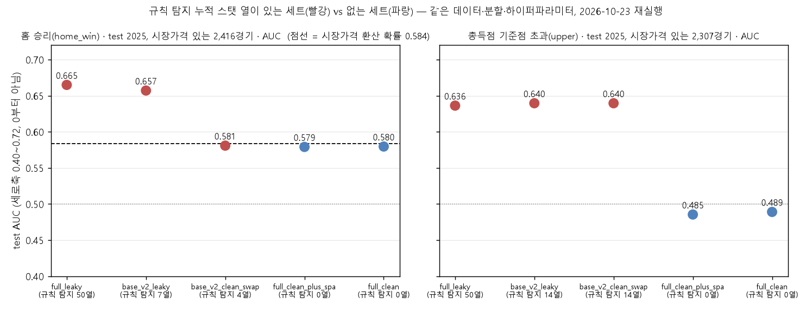
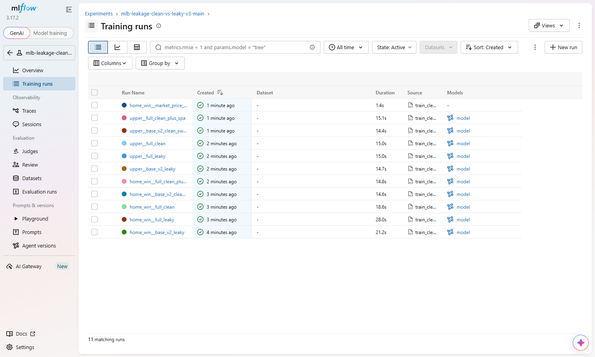

# MLflow 실험 추적: 규칙 탐지 누수 피처 vs 제거 세트 재실험

2026-10-23에 저장소에 보존된 학습 코드(`src/_mlb_train_v3.py`, `experiments/leakage/_mlb_baseline_clean.py`)의 피처와 누수 판정 규칙을 그대로 가져와 로컬 CPU에서 다시 학습했다. 같은 분할에서 규칙 탐지 열이 있는 피처 세트와 없는 세트를 비교하고, 모든 실행을 MLflow로 기록했다. 과거 운영 당시에는 MLflow를 쓰지 않았다.

유효 결과는 batch `20261023T064114`(커밋 `e73544e`)다. 같은 날 앞선 두 실행이 있었다: 첫 실행은 as-of-prior 병합의 중복 키 결함으로 무효, 두 번째는 결함을 고친 뒤의 실행이며 이번 결과와 지표가 완전히 같다(아래 "이전 실행과의 관계").

## 왜 했나

연구 보고서에서 "경기 당일 결과가 선발투수 누적값에 섞이는" 누수를 찾아 고친 과정을 설명했지만, 누수 열이 있는 세트와 없는 세트의 성능 차이를 같은 조건에서 비교한 기록은 노트북 출력과 화면 출력으로만 남아 있었다. 이번에는 파라미터, 지표, 산출물과 실행 코드 사본을 run별로 묶어 남겼다. 어느 설정에서 어떤 결과가 나왔는지 확인할 수 있다.

## 설계

| 항목 | 내용 |
|---|---|
| 데이터 | 운영 당시 학습 테이블 2021~2025 시즌 12,122경기, 250열. 저장소에 포함하지 않음(`--data`로 경로 지정) |
| 열 이름 | 원본 열 이름은 이 저장소의 용어 정리(`docs/CODE_CHANGELOG.md`)와 직접 호환되지 않는다. 로드 직후 로컬 매핑 파일(`--column-map`, 저장소 미포함, 29열)로 저장소의 중립 이름에 연결한 뒤 저장소의 정의를 그대로 쓴다. 매핑 뒤 필요한 열이 없으면 중단 |
| 분할 | train season≤2023 / val 2024 / test 2025. `src/_mlb_train_v3.py`와 동일. `home_win` 7,279/2,422/2,421, `upper` 6,967/2,319/2,312(기준점 결측 524경기 제외) |
| 타깃 | `home_win`(홈 승리), `upper`(총득점 기준점 초과) |
| 모델 | LightGBM 분류기. 하이퍼파라미터는 `src/_mlb_train_v3.LGB_PARAMS` 그대로(n_jobs만 인자), val AUC 기준 early stopping 50 |
| 누수 판정 범위 | `src/_mlb_train_v3.is_leaky`의 이름 규칙: 현재 경기 결과가 포함된 시즌·최근 누적 스탯(era/whip/k9/bb9/hr9/ops/wr/rs/ra 계열). lag1·roll·prior 계열은 경기 전 시점 값이라 유지. **규칙 탐지 0열 = 전체 입력 시점 누수 없음이 아니다.** 시장 피처 등 다른 열의 예측 시점은 감사하지 않았다 |
| as-of-prior SP | 선발투수의 현재 경기 제외 누적치(`--spa`). `_mlb_train_deploy.py`와 같은 방식으로 병합. (game_pk, side) 중복 키 18개·9경기는 어느 값이 맞는지 근거가 없어 해당 경기의 값만 제외(NaN), 경기 행은 삭제하지 않음. 병합은 many_to_one 검증, 병합 후 행 수·gamePk 유일성 검사(`test_merge_spa.py`) |

피처 세트(타깃마다 별도 run):

| run 이름 | 구성 | 규칙 탐지 열 |
|---|---|---|
| `base_v2_leaky` | 종결 v2 베이스라인 피처(승패 12개 / 총득점 22개) | 7 / 14 |
| `base_v2_clean_swap` | 베이스라인에서 era/k9/bb9_diff를 as-of-prior `d_spa_*`로 교체 (`experiments/leakage`와 동일, 승패 베이스라인 전용 규칙이라 `upper`에서는 `base_v2_leaky`와 같다) | 4 / 14 |
| `full_leaky` | 수치형 전체에서 타깃·id·문자열 제외 (원래 v3 main의 FULL) | 50 |
| `full_clean` | `full_leaky`에서 `is_leaky` 열 제거 | 0 |
| `full_clean_plus_spa` | `full_clean` + as-of-prior SP 스탯(home/away/diff) | 0 |
| `market_price_implied` | 참고: 승패 시장가격에서 환산한 확률의 AUC·정확도. 모델 아님. 시장가격이 있는 경기만 | — |

각 run에는 다음 항목을 기록한다.

- params: 타깃, 피처 세트, 피처 수, LightGBM 파라미터, 분할 크기
- metrics: val/test AUC, logloss, acc, n, 시장가격 있는 경기 집합 기준 `*_marketgames_*`, best_iteration, fit_seconds
- tags: 데이터, spa, 매핑 파일의 SHA-256, git 커밋과 dirty, 스크립트, 피처 정의, requirements의 SHA-256, `run_batch_id`
- artifacts: `features.json`, `rule_leaky_columns.json`, `importance.csv`, `result.json`, `data_checks.json`, `code_snapshot/`(실행 당시 코드 사본), LightGBM 모델

## 실행

```bash
uv venv .venv-mlflow --python 3.12
uv pip install --python .venv-mlflow/Scripts/python.exe -r experiments/mlflow/requirements.txt
.venv-mlflow/Scripts/python.exe experiments/mlflow/test_merge_spa.py          # 병합 반례 4건
.venv-mlflow/Scripts/python.exe experiments/mlflow/train_clean_vs_leaky.py \
  --data <DATA_ROOT>/train.parquet --spa <DATA_ROOT>/sp_asof_prior.csv \
  --column-map <DATA_ROOT>/column_map_neutral.json \
  --tracking-uri sqlite:///<DATA_ROOT>/mlflow/mlflow.db --artifact-root file:<DATA_ROOT>/mlflow/mlartifacts \
  --out experiments/mlflow/outputs --experiment-name mlb-leakage-clean-vs-leaky-v3-main
mlflow ui --backend-store-uri sqlite:///<DATA_ROOT>/mlflow/mlflow.db
```

- 저장 백엔드: MLflow 3.17은 파일 저장소(`./mlruns`)를 유지보수 모드로 두고 예외를 내므로 로컬 sqlite를 쓴다. 서버는 띄우지 않는다. 모델 레지스트리는 쓰지 않았다.
- `--quick`은 트리 50개로 동작만 확인하는 smoke 옵션이다. 표의 숫자는 `--quick` 없이 돌린 값이다.
- 스크립트는 `--out` 아래에만 쓴다. 운영 폴더의 기존 모델 파일은 읽지도 쓰지도 않는다.
- `mlflow.db`, `mlartifacts/`, 데이터, 매핑 파일, 모델은 git에 올리지 않는다(저장소 `.gitignore`는 허용 목록 방식). 이 폴더에서 올리는 것은 스크립트, 테스트, requirements, README와 `outputs/summary.csv`, `runs_export.csv`, `data_checks.json`, `code_snapshot/code_manifest.json`뿐이다.

## 결과 (test = 2025)

값은 소수 셋째 자리까지 표시(넷째 자리 반올림)하며 `outputs/summary.csv`에서 스크립트로 생성했다. AUC는 두 모집단으로 적는다. 전체 = test 시즌 전체 경기, 시장가격 있는 경기 = 홈·원정 승패 시장가격이 모두 있는 경기(`market_price_implied`와 같은 모집단).

| 타깃 | 피처 세트 | 피처 수 | 규칙 탐지 열 | val AUC | test AUC 전체 | test AUC 시장가격 있는 경기 | test 정확도 |
|---|---|---:|---:|---:|---:|---:|---:|
| home_win | full_leaky | 234 | 50 | 0.665 | 0.665 | 0.665 (2,416) | 62.2% |
| home_win | base_v2_leaky | 12 | 7 | 0.662 | 0.657 | 0.657 | 57.7% |
| home_win | base_v2_clean_swap | 12 | 4 | 0.601 | 0.581 | 0.581 | 54.4% |
| home_win | full_clean | 184 | 0 | 0.606 | 0.580 | 0.580 | 56.5% |
| home_win | full_clean_plus_spa | 202 | 0 | 0.594 | 0.579 | 0.579 | 56.6% |
| home_win | market_price_implied(참고) | — | — | 0.608 | — | 0.584 (2,416) | 55.6% |
| upper | base_v2_leaky | 22 | 14 | 0.647 | 0.641 | 0.640 (2,307) | 60.4% |
| upper | base_v2_clean_swap | 22 | 14 | 0.647 | 0.641 | 0.640 | 60.4% |
| upper | full_leaky | 234 | 50 | 0.648 | 0.638 | 0.636 | 59.0% |
| upper | full_clean | 184 | 0 | 0.537 | 0.490 | 0.489 | 49.7% |
| upper | full_clean_plus_spa | 202 | 0 | 0.547 | 0.487 | 0.485 | 49.4% |

이번 분할·고정 설정에서, 규칙 탐지 열을 빼면 홈 승리 예측은 같은 2,416경기에서 시장가격 환산 확률과 0.005 안쪽 차이(유의성 미검정)이고 총득점은 우연 수준(0.485~0.489)이다. `upper`의 `base_v2_clean_swap`은 교체 규칙이 승패 베이스라인 전용이라 `base_v2_leaky`와 같다. 시장 대비 우위 유무나 다른 설정으로의 일반화는 이 실험으로 말하지 않는다. 해석·결정·한계는 [docs/mlflow_leakage_experiment.md](../../docs/mlflow_leakage_experiment.md).

## 화면



`outputs/summary.csv`의 시장가격 있는 경기 기준 test AUC. 빨강 = 규칙 탐지 열이 있는 세트, 파랑 = 없는 세트, 점선 = 시장가격 환산 확률. 세로축은 0.40~0.72 구간만 표시한다(0부터 아님).



로컬 MLflow UI(sqlite 백엔드)의 실험 `mlb-leakage-clean-vs-leaky-v3-main` 실행 11건(타깃 2 × 피처 세트 5 + 참고 1). 2026-10-23 실행 직후 캡처.

## 이전 실행과의 관계

같은 날 이 저장소의 공개 전 작업 사본(용어 정리 전 열 이름)에서 두 번 실행했다. 첫 실행은 as-of-prior 병합에서 (game_pk, side) 중복 키 때문에 학습 행이 늘어난 결함으로 무효 처리했고, 결함을 고친 두 번째 실행과 이번 실행(중립 이름 매핑 적용)의 test AUC 차이는 아래와 같다. 전부 같다. 열 이름 매핑이 결과를 바꾸지 않았음을 뜻한다.

| 타깃 | 피처 세트 | 이전(두 번째 실행) | 이번 | 차이 |
|---|---|---:|---:|---:|
| home_win | base_v2_leaky | 0.657 | 0.657 | +0.0000 |
| home_win | full_leaky | 0.665 | 0.665 | +0.0000 |
| home_win | full_clean | 0.580 | 0.580 | +0.0000 |
| home_win | base_v2_clean_swap | 0.581 | 0.581 | +0.0000 |
| home_win | full_clean_plus_spa | 0.579 | 0.579 | +0.0000 |
| upper | base_v2_leaky | 0.641 | 0.641 | +0.0000 |
| upper | full_leaky | 0.638 | 0.638 | +0.0000 |
| upper | full_clean | 0.490 | 0.490 | +0.0000 |
| upper | base_v2_clean_swap | 0.641 | 0.641 | +0.0000 |
| upper | full_clean_plus_spa | 0.487 | 0.487 | +0.0000 |

## 한계

- 하이퍼파라미터를 피처 세트별로 다시 맞추지 않았다. 원래 v3 설정을 고정해 피처 차이만 본 것이다.
- test(2025)는 보고용이며, 피처 세트 선택은 val(2024) 기준이다.
- 누수 판정은 이름 규칙이며 전체 시간적 누수 감사가 아니다. 시장가격 환산 확률과의 비교는 같은 경기 집합이지만 유의성 검정은 하지 않았다.
- 재현을 두 번 실행해 확인하지 않았다. 스레드 수에 따른 차이의 크기도 측정하지 않았다.
- 2026년 이후 데이터·당시 운영 모델의 실제 적중률과는 별개다. 이 비교로 과거 운영 성과를 재평가하지 않는다.
